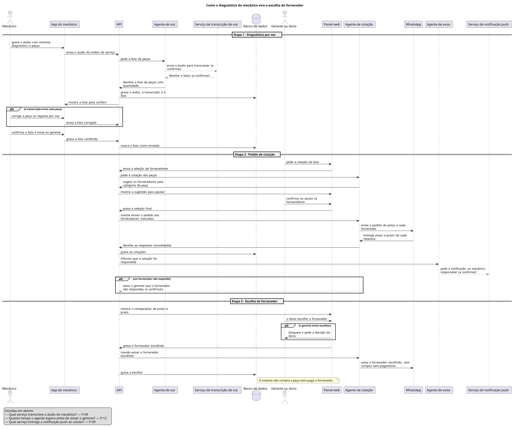
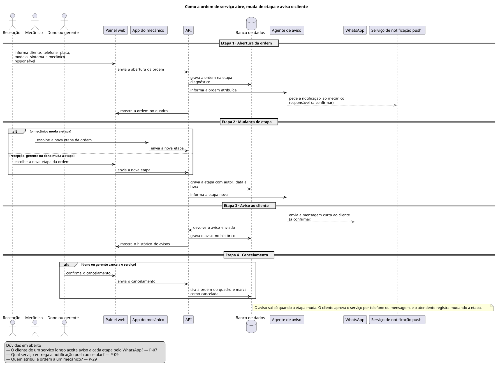

# Arquitetura alvo: FluxoOficina

- Desenho: `docs/demandas/d1-fluxooficina/tecnico/arquitetura-alvo/arquitetura-alvo.html`, aba `v1`

## 1. Visão geral

O FluxoOficina passa a ser um sistema multiagentes que auxilia uma oficina mecânica de porte médio, em duas superfícies. O mecânico usa um app em Expo no celular para gravar o diagnóstico por voz e mudar a etapa do serviço. O dono, o gerente e a recepção usam um painel web no computador para abrir a ordem de serviço, cotar peças, escolher o fornecedor e acompanhar o quadro. Os dois fronts falam só com a API, que guarda tudo no banco e chama os agentes de voz, cotação e aviso. Fornecedores e clientes são alcançados por WhatsApp, e o mecânico recebe notificação push no celular. O código fica em três repositórios (app, painel e API com agentes), e a especificação fica no repositório hub. Dependem de decisão ainda aberta a escolha do serviço de transcrição e do serviço de push, o login e a distribuição do app, e o design system nativo para Expo.

## 2. Jornadas críticas

### Do diagnóstico por voz à peça escolhida

Objetivo em [EF Macro §1](../../ef-macro.md#1-contexto-problema-e-critérios-de-sucesso): reduzir o tempo em que o serviço fica parado esperando preço de peças. A jornada começa quando o mecânico grava o diagnóstico. Ela termina quando o dono escolhe o fornecedor e o agente o avisa.

#### FLOW-01: Como o diagnóstico do mecânico vira a escolha do fornecedor

Fluxo principal. Os diagramas de atividade desta jornada entram na etapa 2.62.

O mecânico grava o áudio no App do mecânico, que o envia à API. A API pede a lista de peças ao Agente de voz, que usa o Serviço de transcrição de voz e devolve a lista. A API grava tudo no Banco de dados e devolve a lista ao app, onde o mecânico corrige o que errou e envia ao gerente. O gerente ou o dono pede a cotação no Painel web. A API aciona o Agente de cotação, que sugere os fornecedores pela categoria da peça. Depois do ajuste, o agente envia o pedido pelo WhatsApp e consolida as respostas. Quando as respostas chegam, o Agente de aviso pede a notificação ao mecânico responsável pelo Serviço de notificação push. A API mostra o comparativo no painel, o dono escolhe o fornecedor, e o Agente de cotação o avisa pelo WhatsApp, sem compra nem pagamento.

**Pendências para fechar a jornada:** falta escolher o serviço de transcrição e o serviço de push, e confirmar o acerto da transcrição com o barulho da oficina (P-08, P-09). Falta definir quanto tempo o agente espera antes de avisar o gerente de que um fornecedor não respondeu (P-12). Falta definir o tamanho máximo do áudio e o tempo de envio pelo celular (P-26).

### Acompanhar o serviço e avisar o cliente

Objetivo em [EF Macro §1](../../ef-macro.md#1-contexto-problema-e-critérios-de-sucesso): reduzir as cobranças de status do cliente. A jornada começa quando a recepção abre a ordem de serviço. Ela termina quando o cliente recebe o aviso da etapa e o histórico fica no painel.

#### FLOW-02: Como a ordem de serviço abre, muda de etapa e avisa o cliente

Fluxo principal. Os diagramas de atividade desta jornada entram na etapa 2.62.

A recepção abre a ordem no Painel web com o mecânico responsável, e a API a grava no Banco de dados na etapa diagnóstico. O Agente de aviso pede ao Serviço de notificação push a notificação ao mecânico. O mecânico muda a etapa pelo App do mecânico, e a recepção, o gerente ou o dono mudam pelo painel. A API grava a etapa com autor, data e hora e informa o Agente de aviso, que envia a mensagem ao cliente pelo WhatsApp. A API grava o aviso no histórico e o mostra no painel. Só o dono e o gerente cancelam o serviço, com confirmação.

**Pendências para fechar a jornada:** falta definir quem atribui a ordem a um mecânico (P-29). Falta confirmar se o cliente de um serviço longo aceita aviso a cada etapa (P-07). Falta definir a regra de orçamento e de aprovação do cliente antes da execução (P-06). Falta definir a regra de cobrança no cancelamento (P-06).

## 3. Restrições e premissas declaradas

| Restrição ou premissa | Tipo | Fonte ou data | O que ela limita |
|---|---|---|---|
| O app do mecânico é em Expo (React Native), com o design system próprio FluxoOficina | premissa declarada | 2026-11-17 | [DA-01](#da-01-duas-superfícies-em-três-repositórios-de-código), [DA-02](#da-02-design-system-próprio-em-repositório-à-parte) |
| O painel é uma aplicação web para computador, com o design system próprio FluxoOficina | premissa declarada | 2026-11-17 | [DA-01](#da-01-duas-superfícies-em-três-repositórios-de-código), [DA-02](#da-02-design-system-próprio-em-repositório-à-parte) |
| O app e o painel funcionam sempre com internet, sem modo offline | premissa declarada | [EF Macro §8.1](../../ef-macro.md#81-constraints-de-plataforma-e-idioma) | [DA-01](#da-01-duas-superfícies-em-três-repositórios-de-código), App do mecânico |
| O código fica em três repositórios (app, painel, API com agentes), e este repositório guarda a especificação | premissa declarada | 2026-11-17 | [DA-01](#da-01-duas-superfícies-em-três-repositórios-de-código), [DA-04](#da-04-contratos-rest-no-repositório-hub) |
| Os fornecedores respondem pedido de preço por WhatsApp | premissa declarada | [EF Macro §9](../../ef-macro.md#9-integrações-e-restrições-conhecidas) | [DA-05](#da-05-agentes-chamados-por-http-interno-sem-fila), Agente de cotação |
| Não há integração com os sistemas dos fornecedores nem compra automática | premissa declarada | [EF Macro §2](../../ef-macro.md#2-escopo) | Agente de cotação |
| O design system é próprio, feito do zero, e fica fora da organização wefit | premissa declarada | [xprints.md](../../xprints.md) | [DA-02](#da-02-design-system-próprio-em-repositório-à-parte) |

## 4. Decisões de arquitetura

### 4.1 Interface

### DA-01: Duas superfícies em três repositórios de código

- **Contexto:** o mecânico trabalha na linha de frente e precisa de celular. Dono, gerente e recepção trabalham no computador.
- **Decisão:** o app do mecânico é em Expo, o painel é web, e a API com os agentes fica à parte. Cada um tem o seu repositório. Este repositório guarda só a especificação e os contratos.
- **Porquê:** a [EF Macro §3](../../ef-macro.md#superfícies) separa as superfícies por persona, e o mecânico prefere interface por áudio, sem digitação longa.
- **Alternativa descartada:** um monorepo único. Facilitaria o compartilhamento de código, e a pessoa preferiu três repositórios para isolar deploy e responsabilidade.
- **Consequência:** tokens do design system e contratos de API precisam ser sincronizados entre os repositórios. A pipeline cria os três repositórios no passo 4.01.
- **Ação do catálogo:** nenhuma
- **Fonte:** [EF Macro §3](../../ef-macro.md#superfícies), [EF Macro §8.1](../../ef-macro.md#81-constraints-de-plataforma-e-idioma)
- **Status:** decidida pela pessoa que conduz a demanda em 2026-11-17

### DA-02: Design system próprio, em repositório à parte

- **Contexto:** o app Expo e o painel web precisam de componentes iguais em nome e em variante, e não existia design system para nenhum dos dois.
- **Decisão:** um design system próprio, feito do zero sobre os componentes do shadcn/ui, com tokens de cor (azul-petróleo, âmbar, neutro frio) e tipografia Inter. Ele vive em [fluxo-oficina-ds](https://github.com/guantunes17/fluxo-oficina-ds), com os pacotes `@fluxo-oficina/tokens`, `@fluxo-oficina/web` e `@fluxo-oficina/native`. Os repositórios do app e do painel o consomem como dependência.
- **Porquê:** o repositório fica fora da organização wefit e pode ser publicado, e os dois fronts dividem uma fonte única de tokens.
- **Alternativa descartada:** adaptar um design system já existente da WeFit. A pessoa decidiu fazer um do zero, sem se inspirar nele, para poder publicá-lo.
- **Consequência:** 20 componentes nos dois pacotes, com 19 testes no web e 28 no nativo, contraste medido no Chrome nos dois temas e o `expo export` compilando para iOS, Android e web. O comportamento em aparelho real não foi verificado, porque o ambiente de desenvolvimento não tinha simulador. A publicação no npm segue pendente da pessoa.
- **Ação do catálogo:** nenhuma
- **Fonte:** [xprints.md](../../xprints.md), [comparação do protótipo](../../prototipo-exploratorio/comparacao.md)
- **Status:** decidida pela pessoa que conduz a demanda em 2026-11-17

### 4.2 BFF

### DA-03: API única, sem BFF

- **Contexto:** o app e o painel pedem operações parecidas sobre as mesmas ordens de serviço.
- **Decisão:** uma API única atende os dois fronts, sem camada BFF.
- **Porquê:** as telas do mecânico e do painel usam o mesmo modelo de dados, e a equipe é pequena.
- **Alternativa descartada:** um BFF para o app e outro para o painel. Duplicaria regras de permissão e contratos sem ganho visível nesta versão.
- **Consequência:** as respostas da API servem aos dois fronts, e o app pode receber campos que não usa. Revisar se o app precisar de resposta própria.
- **Ação do catálogo:** nenhuma
- **Fonte:** [EF Macro §5](../../ef-macro.md#5-requisitos-funcionais)
- **Status:** proposta WeFit

### 4.3 API

### DA-04: Contratos REST no repositório hub

- **Contexto:** três repositórios consomem ou implementam a mesma API.
- **Decisão:** a API é REST sobre HTTPS, e os contratos ficam em `docs/demandas/d1-fluxooficina/contratos/`, neste repositório, como fonte única.
- **Porquê:** os contratos saem do protótipo e dos casos de uso, antes do código, e os três repositórios os leem de um lugar só.
- **Alternativa descartada:** GraphQL. Exigiria mais infraestrutura e não traz ganho para as poucas consultas do painel.
- **Consequência:** mudança de contrato passa por este repositório antes dos três de código.
- **Ação do catálogo:** nenhuma
- **Fonte:** [EF Macro §9](../../ef-macro.md#9-integrações-e-restrições-conhecidas)
- **Status:** proposta WeFit

### 4.4 Segurança e identidade

Hoje não há decisão de login nem de distribuição do app. A matriz de permissões da [EF Macro §3](../../ef-macro.md#matriz-de-permissões-sugestão) vale por perfil, e falta definir como o mecânico entra no app e como o app chega ao celular dele (P-28).

### 4.5 Borda

Nenhuma fonte pede gateway, proteção de borda ou balanceador. O desenho liga os fronts direto à API, e a lacuna fica para a definição de infraestrutura.

### 4.6 Filas

### DA-05: Agentes chamados por HTTP interno, sem fila

- **Contexto:** a API aciona os agentes de voz, cotação e aviso, e a resposta do fornecedor chega depois, pelo WhatsApp.
- **Decisão:** a API chama cada agente por HTTP interno, sem fila de mensagens nesta versão.
- **Porquê:** o volume esperado de uma oficina média é baixo, e a fila acrescentaria uma peça sem necessidade comprovada.
- **Alternativa descartada:** fila de mensagens entre a API e os agentes. Garantiria reenvio, e fica para quando o volume ou a falha de entrega pedirem.
- **Consequência:** falha de um agente chega à API como erro, e a API precisa tratar nova tentativa. Metas de volume e de disponibilidade seguem em aberto (P-12).
- **Ação do catálogo:** nenhuma
- **Fonte:** [EF Macro §10](../../ef-macro.md#10-requisitos-não-funcionais)
- **Status:** proposta WeFit

### DA-08: Notificação push pelo Agente de aviso

- **Contexto:** o mecânico precisa saber, no celular, quando uma ordem é atribuída a ele e quando a cotação das peças dele é respondida.
- **Decisão:** o Agente de aviso pede a notificação a um serviço de push externo, que a entrega ao app do mecânico.
- **Porquê:** o agente já decide quando avisar o cliente, e concentrar os avisos num só agente evita duas regras de aviso espalhadas. A [EF Macro RF-07](../../ef-macro.md#rf-07) pede a notificação.
- **Alternativa descartada:** a API enviar o push direto. Misturaria a regra de aviso com as regras de negócio da API.
- **Consequência:** o serviço de push ainda não foi escolhido (P-09). Os eventos além da ordem atribuída e da cotação respondida estão em aberto (P-30).
- **Ação do catálogo:** nenhuma
- **Fonte:** [EF Macro RF-07](../../ef-macro.md#rf-07)
- **Status:** proposta WeFit

### 4.7 Dados

### DA-06: Banco relacional acessado só pela API

- **Contexto:** ordens, peças, cotações, fornecedores, etapas e avisos se relacionam entre si, como mostra a [EF Macro §4](../../ef-macro.md#4-modelo-de-dados).
- **Decisão:** um banco relacional, acessado só pela API. Os agentes leem e gravam por ela.
- **Porquê:** as entidades têm relações claras, e uma porta única de acesso concentra permissão e auditoria.
- **Alternativa descartada:** um armazenamento próprio para cada agente. Espalharia os dados e dificultaria o histórico da ordem.
- **Consequência:** o áudio e o telefone do cliente exigem política de retenção e de consentimento, ainda em aberto (P-11). Onde fica o arquivo do áudio ainda falta definir.
- **Ação do catálogo:** nenhuma
- **Fonte:** [EF Macro §4](../../ef-macro.md#4-modelo-de-dados)
- **Status:** proposta WeFit

### 4.8 IA

### DA-07: Três agentes separados

- **Contexto:** a solução usa IA em três tarefas diferentes: transcrever e montar a lista de peças, cotar com fornecedores e avisar o cliente.
- **Decisão:** três agentes, um por tarefa: voz, cotação e aviso, chamados pela API.
- **Porquê:** cada tarefa tem entrada, canal e risco diferentes, e a [EF Macro §3](../../ef-macro.md#atores) já os lista como atores separados.
- **Alternativa descartada:** um agente único que decide tudo. Misturaria os canais de voz e de WhatsApp e dificultaria testar cada tarefa.
- **Consequência:** o agente de voz depende de áudio real da oficina para medir o acerto em nome de peças (P-08). O agente de cotação depende da lista de fornecedores cadastrada. A transcrição é um serviço externo ainda não escolhido (P-09).
- **Ação do catálogo:** nenhuma
- **Fonte:** [EF Macro §3](../../ef-macro.md#atores), [EF Macro §5](../../ef-macro.md#5-requisitos-funcionais)
- **Status:** proposta WeFit

### 4.9 Observabilidade

Nenhuma fonte define log, métrica ou rastro. O desenho não traz caixa de observabilidade, e falta definir o que monitorar e quem acompanha (P-12).
